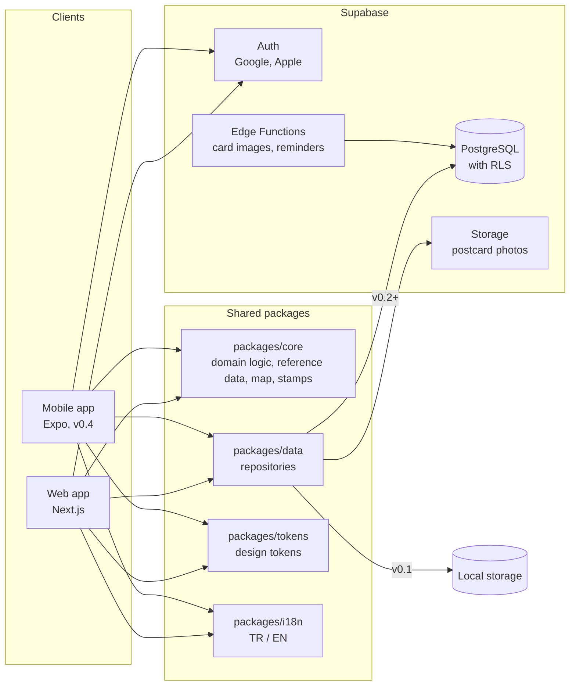

# Postcards – Architecture

Postcards is a personal travel world: where you have been, where you lived, where you want to go, your trips and your memories as digital postcards. Web first, mobile app later, one backend for both.

This document describes the target product, the architecture that supports it, and the order in which to build it. Each phase is shippable on its own.

---

## 1. What makes Postcards different

Many apps only color a world map. Postcards combines five things and adds a reason to come back between trips:

| Pillar | What it is |
| --- | --- |
| **My World Map** | Mark countries as *visited*, *lived* or *want to go*. Tap a country to see your personal history there. |
| **Travel Stats** | Countries, cities, continents, most visited continent, first trip, latest country: fun facts, not just a count. |
| **Digital Passport** | A stamp for every country and collections to complete: first 5, 10, 25 countries, every continent, regions like "Mediterranean". |
| **My Trips** | Upcoming trips with day plans and places to visit; after the trip, an album of postcards. |
| **Community** | Public travel profiles, shared routes and photos, discovering new destinations. |

What only Postcards has:
- **Turkish first**, international from day one.
- **Curated country pages** built from the @postcards.fromworld Instagram content, so the app is never empty.
- **Postcards as content**: every trip turns into shareable postcards, which brings people back after each journey.

---

## 2. Product scope by phase

| Phase | Users get | Why they come back |
| --- | --- | --- |
| **v0.1 Map & Passport** | Map with visited / lived / want to go; country detail (year, note); fun stats; passport stamps and collections; share card. No sign-up; data stays in the browser. | Completing collections, planning the wishlist, sharing |
| **v0.2 Account, Trips & Postcards** | Google/Apple sign-in and sync; trips (past and upcoming, with countries and cities); postcards (photo + note + date); public profile link; markable territories. | Every trip creates new content |
| **v0.3 Planning & Retention** | Day plans and places to visit for upcoming trips; "on this day" memories; yearly recap; curated country pages; traveler levels and badge titles. | Reasons to open the app between trips |
| **v0.4 Mobile** | iOS/Android app, same account and data, push notifications. | Reminders and memories on the phone |
| **v0.5 Community** | Follow travelers, feed of public postcards and routes, discover destinations. | Social |

---

## 3. Key decisions

These are made now so that later phases do not require a rewrite.

| Decision | Choice | Reason |
| --- | --- | --- |
| Repo structure | **Monorepo** (pnpm workspaces + Turborepo) | Web and mobile share types, business logic and design tokens. |
| Web app | **Next.js** (App Router, TypeScript) on Vercel | SEO and link previews for public profiles and postcards; API routes in the same project. |
| Mobile app | **Expo (React Native)** | Reuses the shared TypeScript packages and existing React knowledge. |
| Backend | **Supabase**: PostgreSQL, Auth, Storage, Edge Functions | One backend for web and mobile; Row Level Security. |
| Business logic | **`packages/core`**: pure TypeScript, no React, no browser APIs | Runs unchanged on web, mobile and server; easy to unit test. |
| Data access | **Repository interfaces** with interchangeable implementations | v0.1 stores data locally; v0.2 switches to Supabase without touching the UI. |
| Map | Projection and paths computed with **d3-geo** in `packages/core`, rendered as SVG | Same map data on web (SVG) and mobile (react-native-svg). |
| Reference data | Countries (ISO alpha-2, TR/EN names, continent, regions) in `packages/core`; cities from a geodata source in v0.2 | ISO codes everywhere avoid name mismatches. |
| Gamification | Stamps and collections are **computed** from marks by pure functions, not stored | Rules can change without migrating data. |
| Languages | **i18n from day one** (Turkish, English) | International product. |
| Analytics | Event tracking from v0.1 (e.g. PostHog) | Measures whether people come back. |

> If the mobile app is later built natively (Swift/Kotlin) instead of Expo, the backend, database and API stay the same; only the shared TypeScript packages are not reused.

---

## 4. System overview



---

## 5. Repository structure

```text
postcards/
├── apps/
│   ├── web/                 # Next.js app (v0.1)
│   └── mobile/              # Expo app (v0.4)
├── packages/
│   ├── core/                # domain types, rules, reference data, map geometry, stamps
│   ├── data/                # repository interfaces + local and Supabase implementations
│   ├── tokens/              # colors, spacing, typography for web and mobile
│   └── i18n/                # TR and EN strings
├── supabase/
│   ├── migrations/          # versioned SQL schema
│   └── functions/           # Edge Functions
├── docs/
│   ├── analysis.md          # problem, users, user stories, flows
│   ├── api.md
│   ├── security.md
│   ├── ai-workflow.md
│   └── decisions/           # architecture decision records (ADR)
├── SPEC.md                  # spec of the phase in progress
├── CLAUDE.md
├── ARCHITECTURE.md
└── README.md
```

---

## 6. Domain model

```ts
// packages/core
type CountryCode = string;                       // ISO 3166-1 alpha-2, e.g. "TR"
type MarkStatus = 'visited' | 'lived' | 'wishlist';

interface CountryMark {                          // v0.1
  countryCode: CountryCode;
  status: MarkStatus;
  firstVisitYear?: number;
  note?: string;
  createdAt: string;
}

interface Trip {                                 // v0.2
  id: string;
  title: string;
  startDate?: string;
  endDate?: string;
  status: 'planned' | 'completed';
  stops: TripStop[];
  visibility: 'private' | 'public';
}

interface TripStop {
  countryCode: CountryCode;
  city?: string;
  order: number;
  arrivalDate?: string;
}

interface PlanItem {                             // v0.3
  tripId: string;
  day: number;
  title: string;
  place?: string;
  note?: string;
}

interface Postcard {                             // v0.2
  id: string;
  tripId?: string;
  countryCode: CountryCode;
  city?: string;
  date?: string;
  note?: string;
  photoPath?: string;                            // Supabase Storage path
  visibility: 'private' | 'public';
  createdAt: string;
}

interface Stamp {                                // computed, not stored
  countryCode: CountryCode;
  earnedAt: string;
}

interface Collection {                           // computed, not stored
  id: string;                                    // e.g. "first-10", "all-continents", "mediterranean"
  progress: number;                              // 0–1
  completed: boolean;
}
```

Business rules are pure functions in `packages/core`: `getTravelerTitle`, `getWorldPercent`, `getTravelStats`, `getStamps`, `getCollections`. A completed trip marks its countries as visited.

## 7. Data access

The UI never talks to storage directly:

```ts
// packages/data
interface MarksRepository {
  list(): Promise<CountryMark[]>;
  upsert(mark: CountryMark): Promise<void>;
  remove(code: CountryCode): Promise<void>;
}
// v0.2: TripsRepository, PostcardsRepository with the same pattern
```

| Phase | Implementation |
| --- | --- |
| v0.1 | `LocalMarksRepository` (localStorage) |
| v0.2 | Supabase repositories; on first sign-in, local data is uploaded once |
| v0.4 | Same Supabase repositories on mobile; AsyncStorage as offline cache |

## 8. Database (from v0.2)

```sql
create table profiles (
  id uuid primary key references auth.users,
  username text unique,
  display_name text,
  is_public boolean default false,
  created_at timestamptz default now()
);

create table country_marks (
  user_id uuid references profiles on delete cascade,
  country_code char(2) not null,
  status text not null check (status in ('visited', 'lived', 'wishlist')),
  first_visit_year int,
  note text,
  created_at timestamptz default now(),
  primary key (user_id, country_code)
);

create table trips (
  id uuid primary key default gen_random_uuid(),
  user_id uuid references profiles on delete cascade,
  title text not null,
  start_date date,
  end_date date,
  status text not null check (status in ('planned', 'completed')),
  visibility text not null default 'private' check (visibility in ('private', 'public')),
  created_at timestamptz default now()
);

create table trip_stops (
  id uuid primary key default gen_random_uuid(),
  trip_id uuid references trips on delete cascade,
  country_code char(2) not null,
  city text,
  stop_order int not null,
  arrival_date date
);

create table plan_items (               -- v0.3
  id uuid primary key default gen_random_uuid(),
  trip_id uuid references trips on delete cascade,
  day int not null,
  title text not null,
  place text,
  note text
);

create table postcards (
  id uuid primary key default gen_random_uuid(),
  user_id uuid references profiles on delete cascade,
  trip_id uuid references trips on delete set null,
  country_code char(2) not null,
  city text,
  date date,
  note text,
  photo_path text,
  visibility text not null default 'private' check (visibility in ('private', 'public')),
  created_at timestamptz default now()
);

create table follows (                  -- v0.5
  follower_id uuid references profiles on delete cascade,
  following_id uuid references profiles on delete cascade,
  created_at timestamptz default now(),
  primary key (follower_id, following_id)
);
```

Row Level Security: users read and write only their own rows; public profiles, public trips and public postcards are readable by anyone.

## 9. API

- Web and mobile read and write data through the Supabase client, protected by RLS.
- Server-side work goes to Next.js route handlers or Supabase Edge Functions:
  - `GET /api/card` → share card image (PNG)
  - `GET /api/og/[username]` → link preview for public profiles
  - scheduled function → "on this day" reminders (v0.3)
- Endpoints are documented in `docs/api.md`.

## 10. Security

- RLS on every table; no table without a policy.
- Secrets only in environment variables (Vercel, Supabase), never in the repo.
- Photo uploads: size and type limits, private bucket by default.
- Input validation with shared schemas (e.g. Zod) in `packages/core`.

---

## 11. Build order

### Phase 0 – Foundation
1. Create the monorepo: `apps/web` (Next.js), `packages/core`, `packages/data`, `packages/tokens`, `packages/i18n`.
2. Lint, TypeScript strict mode, Jest, and a GitHub Actions workflow that runs them on every PR.
3. Connect `apps/web` to Vercel.
4. Country reference data (ISO codes, TR/EN names, continents, regions) and map geometry in `packages/core`.

### Phase 1 – v0.1 Map & Passport
1. Domain rules with unit tests: title, percentage, stats, stamps, collections.
2. `LocalMarksRepository`.
3. Map: tap to mark, choose visited / lived / want to go.
4. Country detail: status, first visit year, note.
5. Search and visited list.
6. Travel Stats screen.
7. Passport screen: stamps and collections.
8. Share card.
9. Design from the chosen reference applied through `packages/tokens`.
10. Analytics events; release; README with the live link.

### Phase 2 – v0.2 Account, Trips & Postcards
1. Supabase project, migrations, RLS.
2. Google sign-in; upload local data on first sign-in.
3. Supabase repositories.
4. Trips (past and upcoming) with stops.
5. Postcards with photo upload; trip album.
6. Public profile page with link preview.
7. Territories (Greenland, Puerto Rico, New Caledonia, …) as markable places that do not count as countries; grey and not markable in v0.1 (ADR 0005).

### Phase 3 – v0.3 Planning & Retention
1. Day plans and places to visit.
2. "On this day" reminders (email first).
3. Curated country pages.
4. Yearly recap.
5. Gamification: traveler levels and badge titles (e.g. "Seviye 4: Kıtalararası Gezgin", "Tutkulu Kaşif") on top of the six v0.1 titles; computed from marks and trips like stamps (see `docs/decisions/0003-design-scope-v0.1.md`).

### Phase 4 – v0.4 Mobile
1. `apps/mobile` with Expo, reusing the shared packages.
2. Map with react-native-svg.
3. Push notifications.
4. Store releases.

### Phase 5 – v0.5 Community
1. Follow, feed of public postcards and routes.
2. Discover destinations from other travelers.

Each step is one spec section, one branch and one PR.
